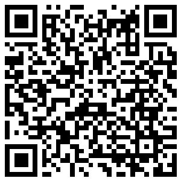

# asteroid-orbit-3d-webgl

Watch about 1.58 million asteroids from Lowell Observatory's astorb catalog orbit the Sun, in 3D, in your web browser.

[https://jwshaffstall.github.io/asteroid-orbit-3d-webgl/astorb3d.html](https://jwshaffstall.github.io/asteroid-orbit-3d-webgl/astorb3d.html)



## Overview

astorb3d draws every asteroid in the catalog as a point and moves it along its orbit with two-body Kepler motion, computed on the GPU in a WebGL vertex shader. Planets, dwarf planets and a few moons are drawn alongside. The scene opens at today's date and runs at about 12 days per second; you can pause, speed up, reverse and jump back to now.

## Controls

- **Mouse / touch**: drag to orbit the camera around the ecliptic, scroll or pinch to zoom.
- **Keyboard**: Space pauses, ↑/↓ change the speed, `0` jumps to now, `C` toggles cinematic mode, `R` randomizes the look.
- **Buttons**: the same time, density and display controls, for touch devices.
- **URL options** (handy for sharing a view or for tests): `?t=<seconds since the epoch>&cam=<azimuth°>,<elevation°>,<distance AU>&color=<0-4>&paused=1`.

## How accurate is it?

astorb3d aims to be a faithful visualization, not an ephemeris or an impact-prediction service.

- **Asteroids** move by two-body Kepler motion from the catalog's epoch (shown in the footer). Lowell notes that most asteroids stay accurate to arcseconds within about ±50 days of the epoch; further away, real perturbations add up, faster for near-Earth objects.
- **Planets** use JPL's approximate Keplerian elements and rates (E. M. Standish, Table 1), fitted for 1800–2050. Within that range they are within about 0.1° of JPL Horizons; outside it the status bar says positions are approximate. The reachable range is ±1,000 years from the epoch.
- **Moon orbits** are illustrative: not in their real planes or phases.

Tests check the planets and a set of asteroids against JPL Horizons vectors (`npm test`).

## Data pipeline

The app loads `temp/astorb3d.meta.json` (epoch, record count, snapshot checksum) and then `temp/astorb3d.bin`: Float32, little-endian, six values per asteroid (mean anomaly, argument of perihelion, longitude of ascending node, inclination, eccentricity, semi-major axis).

Both are built from a raw Lowell snapshot recorded in `data/manifest.source.json`:

```bash
npm run data:build     # rebuild from the archived snapshot (byte-identical)
npm run data:refresh   # download the latest catalog, rebuild, validate and test
```

See [project_context.md](project_context.md) for the full command list and code map.

## Development

```bash
npm ci
npm run dev            # Vite dev server
npm test               # unit, data and accuracy tests
npm run test:e2e       # browser tests (Playwright)
npm run lint
npm run format
```

## Data credits

Asteroid orbital elements: [Lowell Observatory astorb database](https://asteroid.lowell.edu/astorb/). The astorb database is funded by NASA grant NAG5-4741 (PI E. Bowell), the Lowell Observatory endowment, and NASA PDART grant NNX16AG52G (PI N. Moskovitz). Please cite [doi:10.1016/j.ascom.2022.100661](https://doi.org/10.1016/j.ascom.2022.100661).

Planet elements: [JPL Solar System Dynamics, approximate positions of the planets](https://ssd.jpl.nasa.gov/planets/approx_pos.html). Reference vectors and dwarf-planet elements: [JPL Horizons](https://ssd.jpl.nasa.gov/horizons/).

## License

The code is released into the public domain (see `LICENSE.txt`). Bundled third-party libraries keep their own licenses (see `THIRD_PARTY_NOTICES.md`).
